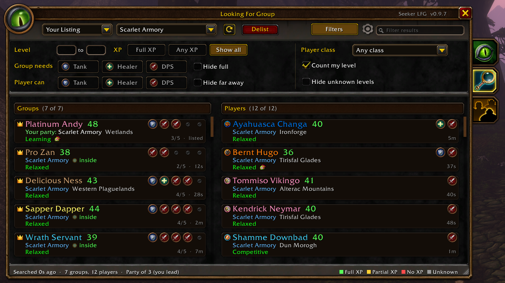
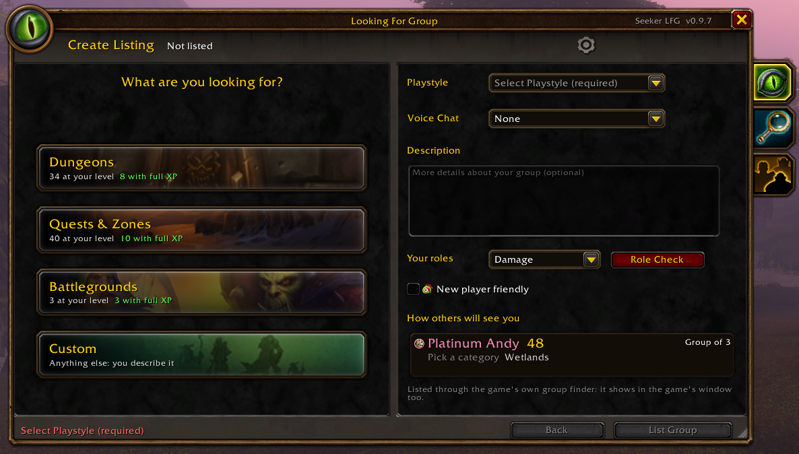
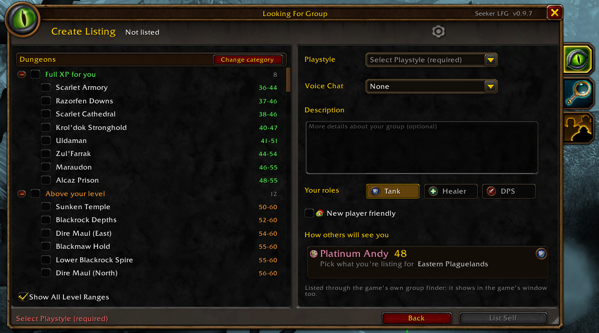

# Seeker LFG

**Looking for Group for WoW Forever, with groups and players side by side and filters that keep your dungeon runs earning XP.**

Seeker LFG replaces Forever's Looking for Group window with one that looks and feels like the game's own, but shows far more. It also does everything the game's window does, so you never need to open that window again.

*Browsing for your own listing's dungeon: your party at the top, groups already inside the dungeon marked, levels coloured by the XP you'd get.*

## Why Seeker

- **Keep your XP.** Kill XP is lost when the highest-level party member is more than 12 levels above the mob. Every group and player is checked against that rule, and the level is coloured: green for full XP, yellow for partial XP, red for none. One click hides everything that would cost you XP.
- **See where people are.** Every player's zone is shown, in red when they're on the wrong continent for their dungeon (someone in Kalimdor queued for the Deadmines) and in green when they're already there. Group tooltips show where every member is, too.
- **Groups and players side by side,** in the game's own style, with each party's roles at a glance.
- **Everything the game's window does:** list yourself or your group, browse, invite, report, and search /who.

## Browse

- **Groups on the left, players on the right.** Each card shows the name and level, the dungeon and zone, the playstyle, the party's roles (or the player's), the group's size and how long ago it was listed.
- **Filters:** XP (full only, any, or all), level range, groups that need a tank / healer / DPS, players who can tank / heal / DPS, player class, hide full groups, and hide far-away players.
- **Activities by XP:** the activity menu sorts dungeons into Full XP for you, Above your level, Some XP and No XP for you. One click picks every dungeon with full XP for you.
- **Friends and guildmates:** listings with them in get a badge and sort near the top.
- **Sort:** best XP, newest, oldest, level either way, biggest groups first, or the game's own order (groups with a seat for your roles first).
- **Shown like the game shows them:** each activity's own display (the listing's note, a player count, class icons, role counts or seats), listings taken down since your search greyed out rather than gone, and activities grouped either by XP or by the game's own groups.
- **Tooltips:** every member with level, role and location, the group's note, playstyle, voice chat and bosses already killed.
- **Groups from chat:** groups and players looking for a dungeon in chat channels ("LF2M SM Arm need heal") appear beside the group finder's listings, marked chat, with the same filters.
- **Whom you've asked:** cards show when you've asked a group to join or invited a player, and whether they replied, declined or joined.
- **Fill my group:** for leaders, one click shows the players who'd fill your group's missing roles, with full XP for it.
- **Notes and setups:** keep a note on players you've grouped with, and save filter setups to switch between ("Tanking on my warrior").
- **Request to join.** Forever has no "apply to group", so this opens a whisper to the leader with your request already written; press Enter to send it.
- **Hide players and spam:** right-click a listing > Hide to never see that player's listings again, hide everyone on your ignore list, and hide listings whose title or note mentions words you pick (Options > AddOns > Seeker LFG, or `/seeker hidewords wts, boost`).
- **Alerts:** new groups and players that pass your filters are announced in chat with a sound. Bind **Search again** (Keybindings > Seeker LFG) to check without opening the window.

## List yourself

*Listing a group of three: pick a category, your role and a playstyle, and see how others will see you.*

Pick a category, tick what you're listing for, and choose a playstyle, voice chat, a description, your roles and "new player friendly". A preview shows how other players will see your listing. When you're in a group, you get the role dropdown and a role check, and only the leader can change the listing.

*Activities grouped by XP for you, with each one's level range.*

Activities are grouped by what they'd give you in XP, so you can see straight away which dungeons are worth listing for. Dungeons you'd get no XP from, and instances you're saved to, are flagged before you post.

## Who

A /who search with class, race and zone filters, and an invite button for each player. Click a column heading to sort by it (again to reverse). Your filters and sort are kept between sessions, and your results stay put while Seeker looks up group members in the background.

## Your own messages

**Messages** in the cog menu, or `/seeker messages`, lets you write your own **Request to join** message, and an **Invite** message that's whispered to players when you invite them. These placeholders are filled in for each listing:

| Placeholder | Becomes |
|---|---|
| `[level]` | your level |
| `[class]` | your class |
| `[roles]` | the roles you've ticked, e.g. Tank/Healer |
| `[dungeon]` | the dungeon they're listed for |
| `[name]` | your name |
| `[target]` | their name |
| `[zone]` | the zone you're in |

`Hey [target], [level] [class] here, free for [dungeon]?` becomes "Hey Skeron, 21 Mage here, free for Deadmines?". The window shows a preview as you type.

## Install

Install it from CurseForge (the CurseForge app, with WoW Forever picked), or by hand:

1. Download `SeekerLFG-x.y.z.zip` from [Releases](../../releases).
2. Unzip it into `World of Warcraft\_forever_\Interface\AddOns\` so that you have an `AddOns\SeekerLFG` folder.
3. Restart the game, then type `/seeker`.

## Using it

- Open it with `/seeker` (or `/slfg`), the minimap eye, or the addon compartment. The minimap eye watches while you're listed, like the game's own.
- The minimap button works with minimap button collectors, and Seeker also shows in broker bars (Titan Panel, ChocolateBar, Bazooka and the like).
- To use Seeker for good, open the cog menu and turn on **Replace the game's Looking for Group window**. The game's keybind and menu button then open Seeker, and holding Shift opens the game's window instead.
- Drag the corner grip down to make the window taller (more cards), or use Ctrl + mouse wheel to scale everything.
- Every setting is also in **Options > AddOns > Seeker LFG**.
- If you have **Whisper Messenger**, whispers open there.

| Command | What it does |
|---|---|
| `/seeker` | Open or close the window |
| `/seeker messages` | Your Request to join and invite messages |
| `/seeker settings` | The options page |
| `/seeker replace` | Switch replacing the game's window on or off |
| `/seeker blizzard` | Open the game's own Looking for Group window |
| `/seeker minimap` | Show or hide the minimap button |
| `/seeker reset` | Reset the window's position and size |
| `/seeker ignore <name>` / `unignore <name>` | Hide a player's listings, or show them again |
| `/seeker ignored` | List the players you've hidden |
| `/seeker hidewords <a, b>` | Hide listings that mention any of these words (leave empty to clear) |
| `/seeker fill` | Leaders: show the players who'd fill your group's missing roles |
| `/seeker setup [name]` / `setup save <name>` | Switch to a saved filter setup, or save your current filters |
| `/seeker note <name> [text]` | Your note on a player (no text removes it) |
| `/seeker chattest <message>` | Show how Seeker reads a chat message (for bug reports) |
| `/seeker selftest` | Check everything Seeker relies on in the game (for bug reports) |
| `/seeker debug` | Print what the game's group finder reports (for bug reports) |
| `/seeker help` | List every command |

## Good to know

- **Mob levels are estimates,** taken from each dungeon's suggested level range.
- **Member locations:** the game only shares where a group's lister is. To see where the other members are, point at the group's card and click its map button: Seeker checks the group's zone first with a quiet /who (which usually finds everyone at once), then any member it missed, about one every five seconds while you click or press keys with the window open (the game only allows /who on input). Only the groups you ask about are looked up. Seeker also remembers zones from your friends list, guild roster and any /who.
- **Descriptions** are typed into the game's own description box, shown inside Seeker's window. The game only accepts listing text typed there. Seeker loads that part of the game's interface itself, once you're out of combat.
- **Playstyle** is set when you list. The game doesn't let a listing's playstyle change, so delist and list again to change it.
- **Other languages:** Seeker uses the game's own wording where it has it. The rest is in English until it's translated; see `Locale.lua` to add a translation.

## Bugs and ideas

Open an [issue](../../issues). For bugs, include the output of `/seeker selftest`.
